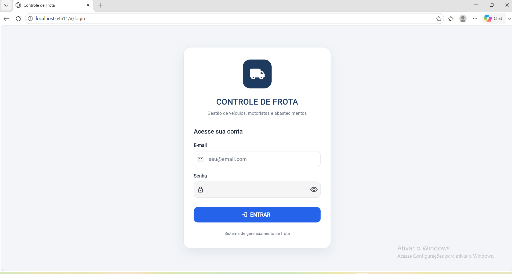
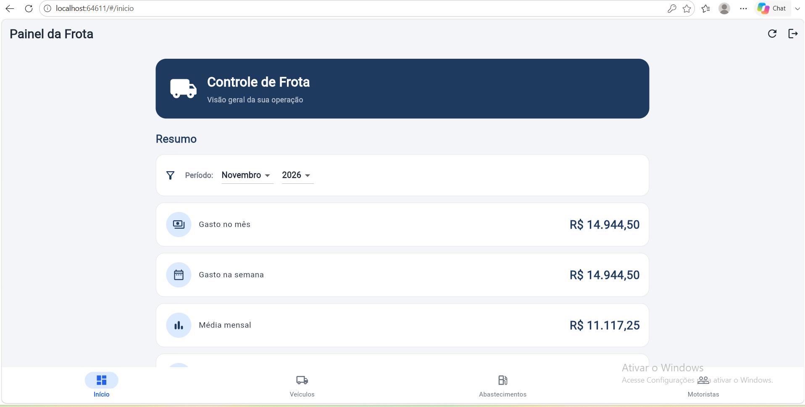
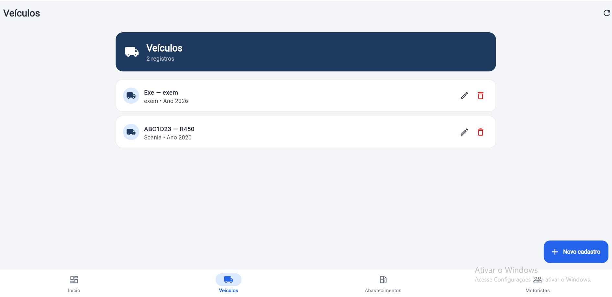
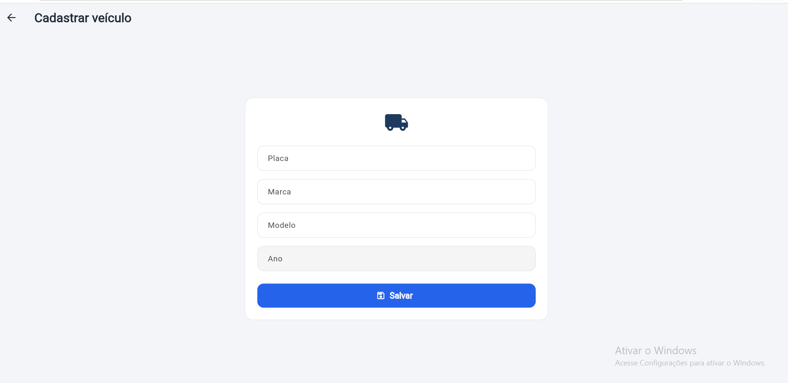
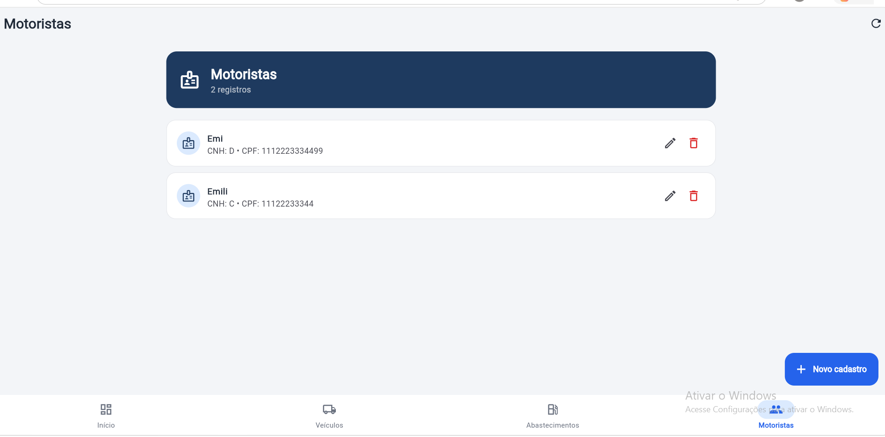
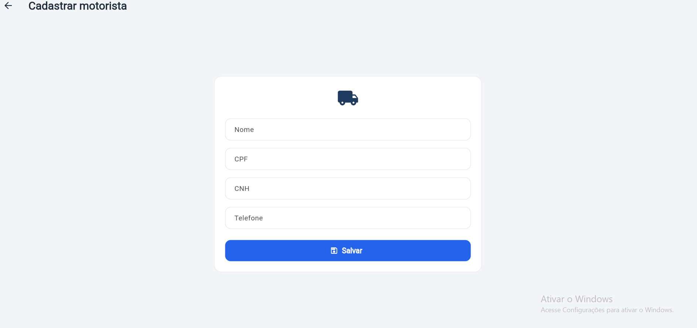
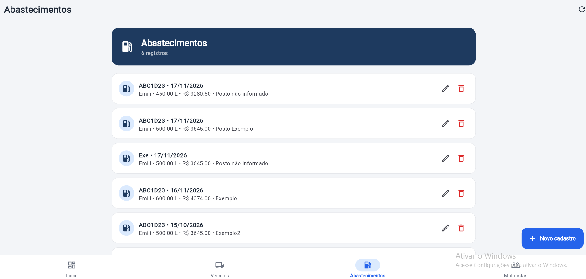
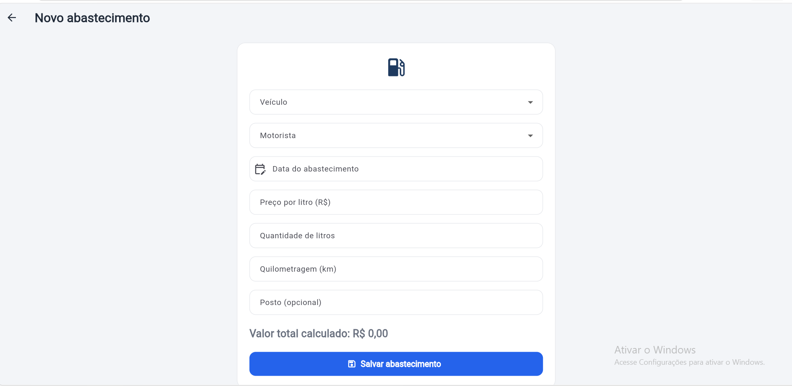

# Controle de Frota

Projeto acadêmico de Desenvolvimento Mobile — Engenharia de Software, UniGuairacá.

**Aluna:** Êmili Vitória da Silva  
**Back-end escolhido:** Opção A — Laravel (API REST)  
**Tecnologias:** Flutter, Dart, Laravel, PHP, SQLite e Laravel Sanctum.

Um aplicativo para gerenciamento de frotas de veículos. O usuário pode cadastrar **veículos**, gerenciar **motoristas**, registrar **abastecimentos** e acompanhar os gastos com combustível.

O sistema possui autenticação de usuários, operações CRUD e um painel inicial com indicadores da frota.

---

## Como rodar

O projeto está dividido em duas partes:

- `mobile/` — aplicativo Flutter.
- `backend/` — API REST desenvolvida em Laravel.

### 1. Pré-requisitos

Para executar o projeto, é necessário ter instalado:

- Flutter SDK e Dart.
- PHP e Composer.
- Ambiente configurado para Laravel.
- Banco de dados SQLite.
- Microsoft Edge ou um dispositivo compatível com Flutter.

### 2. Executando o back-end

Abra um terminal na pasta do projeto:

```bash
cd backend
composer install
```

Configure o arquivo `.env` com as informações do banco de dados e gere a chave da aplicação, se necessário:

```bash
php artisan key:generate
```

Execute as migrations:

```bash
php artisan migrate
```

Inicie o servidor Laravel:

```bash
php artisan serve
```

Por padrão, o Laravel disponibiliza a API em:

`http://127.0.0.1:8000`

A rota `/api/health` pode ser utilizada para verificar a comunicação com o servidor.

### 3. Executando o Flutter

Em outro terminal, acesse a pasta `mobile`:

```bash
cd mobile
flutter pub get
flutter run -d edge
```

O aplicativo será iniciado no navegador.

A URL da API utilizada pelo Flutter deve estar configurada corretamente em:

`lib/services/auth_service_laravel.dart`

> O back-end precisa estar em execução para que o aplicativo consiga autenticar usuários e consultar os dados.

---

## Estrutura de pastas

A organização utiliza uma **arquitetura em camadas**, separando interface, modelos, serviços e acesso aos dados.

```text
controle-frota-app/
│
├── backend/
│   ├── app/
│   │   ├── Http/
│   │   │   ├── Controllers/
│   │   │   ├── Middleware/
│   │   │   └── Requests/
│   │   └── Models/
│   ├── database/
│   │   └── migrations/
│   ├── routes/
│   └── ...
│
├── mobile/
│   ├── lib/
│   │   ├── main.dart
│   │   ├── app.dart
│   │   │
│   │   ├── core/
│   │   │   ├── routes/
│   │   │   ├── theme/
│   │   │   └── utils/
│   │   │
│   │   ├── models/
│   │   ├── repositories/
│   │   ├── services/
│   │   │
│   │   ├── screens/
│   │   │   ├── auth/
│   │   │   ├── home/
│   │   │   ├── vehicles/
│   │   │   ├── drivers/
│   │   │   ├── fuelings/
│   │   │   └── shell/
│   │   │
│   │   └── widgets/
│   │
│   └── pubspec.yaml
│
├── prints/
└── README.md
```

### Responsabilidade de cada camada

- **Models:** representam as entidades e os dados do sistema.
- **Repositories:** abstraem as operações de consulta, cadastro, atualização e exclusão.
- **Services:** realizam a comunicação com a API e concentram serviços relacionados à aplicação.
- **Screens:** apresentam as telas e recebem as interações dos usuários.
- **Widgets:** disponibilizam componentes reutilizáveis.
- **Core:** contém configurações de rotas, tema e utilitários.

### A regra que sustenta tudo

O projeto busca manter uma separação clara de responsabilidades:

```text
Screens / Widgets
        |
        v
   Repositories
        |
        v
     Services
        |
        v
  API REST Laravel
        |
        v
   Banco SQLite
```

A autenticação utiliza o serviço específico `AuthServiceLaravel`.

Na prática:

- As telas não precisam realizar requisições HTTP diretamente.
- O Repository centraliza o acesso às operações da frota.
- Os Services concentram a comunicação com o back-end.
- Os Models representam os dados utilizados no aplicativo.
- Os Widgets permitem reutilizar elementos entre diferentes telas.

Essa estrutura facilita a manutenção, a organização e a evolução do sistema.

---

## O que foi desenvolvido

| Área | Implementação |
|------|---------------|
| Autenticação | Login e logout |
| Navegação | go_router e barra inferior |
| Veículos | Cadastro, listagem, edição e exclusão |
| Motoristas | Cadastro, listagem, edição e exclusão |
| Abastecimentos | Registro, consulta, edição e exclusão |
| Painel inicial | Indicadores e gastos com combustível |
| Integração | Consumo de API REST Laravel |
| Segurança | Autenticação por token com Sanctum |
| Arquitetura | Separação em Models, Services, Repositories, Screens e Widgets |
| Qualidade | Análise estática com Flutter Analyze |

---

## Telas do aplicativo

### Login — SignInScreen

Permite que o usuário informe suas credenciais para acessar o sistema.

### Início — HomeScreen

Apresenta os principais indicadores:

- Quantidade de veículos cadastrados.
- Quantidade de motoristas cadastrados.
- Quantidade de abastecimentos registrados.
- Gastos com combustível no mês.
- Gastos na semana.
- Média mensal de gastos.
- Filtro por mês e ano.

### Veículos — VehiclesScreen

Permite visualizar e gerenciar os veículos da frota.

### Cadastro de veículo — VehicleFormScreen

Formulário utilizado para registrar veículos.

### Motoristas — DriversScreen

Permite visualizar, cadastrar, editar e excluir motoristas.

### Abastecimentos — FuelingsScreen

Permite consultar e gerenciar abastecimentos.

### Formulário de abastecimento — FuelingFormScreen

Permite informar veículo, motorista, data, preço por litro, quantidade de litros, quilometragem e posto.

O valor total do abastecimento é calculado automaticamente.

---


## Rotas

O aplicativo utiliza o pacote `go_router` para gerenciar a navegação.

As rotas são centralizadas em `lib/core/routes/app_routes.dart`.

| Caminho | Nome constante | Tela |
|---------|----------------|------|
| `/login` | `AppRoutes.signIn` | Login |
| `/inicio` | `AppRoutes.home` | Painel inicial |
| `/veiculos` | `AppRoutes.vehicles` | Veículos |
| `/motoristas` | `AppRoutes.drivers` | Motoristas |
| `/abastecimentos` | `AppRoutes.fuelings` | Abastecimentos |

A navegação principal possui quatro abas: Início, Veículos, Abastecimentos e Motoristas.

Para navegar, utilizamos as constantes definidas em `AppRoutes`, evitando escrever os caminhos diretamente:

```dart
context.goNamed(AppRoutes.vehicles);
```


## Back-end — Opção A

O back-end foi desenvolvido em Laravel, disponibilizando uma API REST consumida pelo Flutter.

A autenticação utiliza Laravel Sanctum.

### Principais endpoints

| Método | Endpoint | Descrição |
|--------|----------|-----------|
| POST | `/api/login` | Login |
| GET | `/api/me` | Usuário autenticado |
| POST | `/api/logout` | Logout |
| GET | `/api/vehicles` | Listar veículos |
| POST | `/api/vehicles` | Cadastrar veículo |
| PUT | `/api/vehicles/{id}` | Editar veículo |
| DELETE | `/api/vehicles/{id}` | Excluir veículo |
| GET | `/api/drivers` | Listar motoristas |
| POST | `/api/drivers` | Cadastrar motorista |
| PUT | `/api/drivers/{id}` | Editar motorista |
| DELETE | `/api/drivers/{id}` | Excluir motorista |
| GET | `/api/fuelings` | Listar abastecimentos |
| POST | `/api/fuelings` | Cadastrar abastecimento |
| PUT | `/api/fuelings/{id}` | Editar abastecimento |
| DELETE | `/api/fuelings/{id}` | Excluir abastecimento |

As rotas protegidas exigem autenticação.

O back-end também possui validações e controle de permissões para operações de escrita.

---

## Convenções de código

O projeto adota práticas de organização e reutilização:

- Arquivos e pastas em `snake_case`.
- Classes em `PascalCase`.
- Componentes compartilhados em `lib/widgets/`.
- Separação entre interface e acesso aos dados.
- Reutilização de formulários e listagens.
- Tratamento de erros de comunicação com a API.
- Verificação de campos obrigatórios nos formulários.
- Uso de constantes para rotas e cores.

Antes da entrega, os seguintes comandos podem ser executados na pasta `mobile`:

```bash
dart format .
flutter analyze lib
flutter test
```

A análise estática realizada durante o desenvolvimento não apresentou erros ou warnings, permanecendo apenas mensagens informativas de depreciação do Flutter.

---

## Capturas de tela

As capturas de tela do aplicativo devem ser armazenadas na pasta `prints/` na raiz do projeto.

### 1. Login



### 2. Painel inicial



### 3. Veículos



### 4. Cadastro de veículo



### 5. Motoristas




### 6. Cadastro de motorista



### 7. Abastecimentos



### 8. Cadastro de abastecimento



---

## Considerações finais

O Sistema de Controle de Frota foi desenvolvido como atividade acadêmica para aplicar conceitos de programação mobile, integração com APIs REST, autenticação e organização de código.

A aplicação utiliza Flutter no front-end e Laravel no back-end, permitindo gerenciar veículos, motoristas e abastecimentos.

O projeto também aplica conceitos de arquitetura em camadas, reutilização de componentes e separação de responsabilidades, contribuindo para a manutenção e evolução do software.
